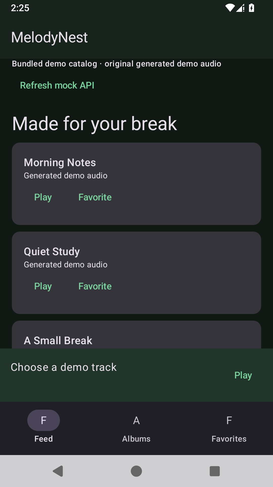
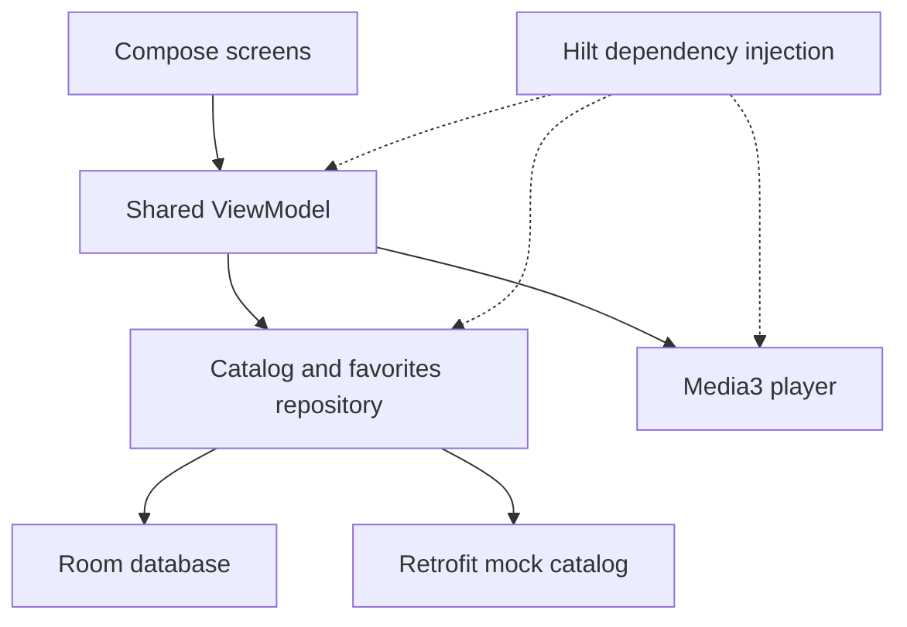

# MelodyNest

### A Compose music library with shared playback state

An Android music app scaffold with a browsable demo catalog, album and favorites screens, and a shared foreground player. Built around MVVM and Android Jetpack components.

**Kotlin · Jetpack Compose · Navigation · Hilt · Room · Retrofit · Media3 ExoPlayer**

[Run in Android Studio](#open-in-android-studio) · [Validation](docs/VALIDATION.md) · [Development roadmap](docs/NEXT_STEPS.md)

<p align="center">
  
</p>

*Actual API 35 Android emulator capture. The app launched with its bundled synthetic catalog; no Spotify account or commercial tracks are used.*

## Engineering highlights

- Compose screens share a ViewModel across feed, albums and favorites navigation.
- Hilt wires the repository, Room favorites store and Retrofit catalog client.
- A shared Media3 player exposes foreground playback state to the UI.
- The app bundles three synthetic tracks and an original demo tone; a local mock API supplies an optional catalog refresh.
- GitHub Actions builds the debug APK, runs JVM tests, and captures a real emulator preview in a separate workflow.

## Architecture



## Current scope

| Included in the scaffold | Next milestones |
| --- | --- |
| Feed, albums and favorites UI | Full device interaction tests |
| Room favorites and foreground player code | Background playback and notifications |
| Bundled demo catalog and mock API client | Authentication and a real HTTPS catalog |

**Status: builds and launches in an emulator; still in active development.** Playback, favorites persistence and navigation need broader device verification. There is no Spotify service integration. [Screenshot reproduction](docs/SHOWCASE.md).

## Open in Android Studio
Open the repository root. Install SDK Platform 35 and Build Tools 35.0.0 using Android Studio, select a JDK 17+ compatible Gradle JVM, sync, and run `app` on an API 26+ emulator/device. The project pins AGP 8.9.2, Kotlin/Compose compiler 2.1.20 and Gradle 8.11.1.

```sh
./gradlew assembleDebug testDebugUnitTest
# Windows PowerShell: .\gradlew.bat assembleDebug testDebugUnitTest
```

## Optional mock server
```sh
cd mock-api
npm ci
npm start
```

The Android Emulator uses `http://10.0.2.2:3001/`. For a USB-connected physical device, run `adb reverse tcp:3001 tcp:3001` and change the debug base URL to `http://127.0.0.1:3001/`. The mock server stays bound to the development machine loopback interface. Cleartext HTTP is enabled only in the debug manifest. The release URL is an explicit invalid placeholder until a real HTTPS API is configured.

## Status and next steps
Android debug build and JVM unit tests passed in GitHub Actions. Download the debug APK from the debug APK artifact in the [verified workflow run](https://github.com/Ke1no/MelodyNest/actions/runs/40437934459). An API 35 emulator launch and feed visibility check also passed in the [preview workflow](https://github.com/Ke1no/MelodyNest/actions/runs/40437934443). Full navigation, playback and persistence behavior still require device testing.

See [development roadmap](docs/NEXT_STEPS.md), [architecture](docs/ARCHITECTURE.md), and [validation](docs/VALIDATION.md). This scaffold has no Spotify integration, signing key, Play Store release or cloud deployment.
